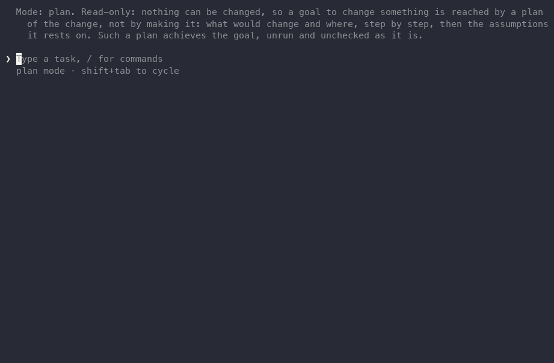

<p align="center">
  
</p>

<h1 align="center">llx</h1>

<p align="center">
  <strong>Ultrafast, lightweight agent runtime</strong>
</p>

<p align="center">
  A native window of real browser pages and terminals that any agent can work in, a decision step for scripts and CI, and a minimal agent for your terminal. One binary under 4 MB, no plugins.
</p>

<p align="center">
  <a href="#install">Install</a> ·
  <a href="docs/usage.md">Documentation</a> ·
  <a href="#in-other-agents">In other agents</a> ·
  <a href="#in-ci-and-scripts">In CI</a> ·
  <a href="https://llx.sh">llx.sh</a>
</p>

<p align="center">
  <a href="https://llx.sh">
    
  </a>
</p>

llx is the part of an agent that touches the world. It opens real browser pages and real terminal sessions as tabs of one native window, grouped by project, where you can watch them work. A short `goal` on a tab goes to a small, fast decision model that clicks and types step by step. It runs three ways, from the same binary:

| Who calls | Command | What they get |
| --- | --- | --- |
| **You** | `llx` | A minimal agent at your terminal, with seven tools: `read`, `edit`, `bash`, `window`, `ask`, `agents`, `jobs` |
| **Your scripts and CI** | `llx exec --json --schema …` | One task, then exit: JSON events, an answer in the shape you define, exit codes to branch on |
| **Your other agents** | `llx mcp` | The same window, served over MCP to Claude Code, Codex, Cursor or any client |

<table>
  <tr>
    <td width="33%" valign="top">
      <strong>Real pages, real shells</strong><br>
      The system's WebView and PTY terminals as tabs of one window, grouped by project. The window never takes your keyboard.<br>
      <a href="docs/tools.md">The window →</a>
    </td>
    <td width="33%" valign="top">
      <strong>Say the goal</strong><br>
      "Book the cheapest flight on Friday": a small model does the clicking. Median task 8.5 s, $0.002 in our evals.<br>
      <a href="benchmarks/HISTORY.md">Benchmarks →</a>
    </td>
    <td width="33%" valign="top">
      <strong>Point at the problem</strong><br>
      Click an element on a page, write a note, Send. The agent gets its selector, source file, styles and a picture.<br>
      <a href="docs/mcp.md">Comments →</a>
    </td>
  </tr>
  <tr>
    <td valign="top">
      <strong>A step in your pipeline</strong><br>
      <code>llx exec</code> answers to your JSON Schema and exits with a code CI can branch on.<br>
      <a href="docs/ci.md">CI →</a>
    </td>
    <td valign="top">
      <strong>Small on purpose</strong><br>
      Under 4 MB, starts in about 5 ms. About 200 model providers: a ChatGPT sign-in, OpenRouter, or a key.<br>
      <a href="MODELS.md">Models →</a>
    </td>
    <td valign="top">
      <strong>Reading never asks</strong><br>
      Every command, file change and page action asks first, unless a rule allows it: <code>--allow 'bash(cargo test *)'</code>, or a mode of your own.<br>
      <a href="docs/modes.md">Modes →</a>
    </td>
  </tr>
</table>

## Install

```bash
npm install -g @localixai/llx
```

Or `curl -fsSL https://raw.githubusercontent.com/rsaryev/llx/main/scripts/install.sh | sh` (macOS and Linux x86_64, checked against `SHA256SUMS`), or `cargo install --locked --path apps/cli` from a clone. The browser is the system's WebView: WKWebView on macOS, WebKitGTK (`libwebkit2gtk-4.1-0`) on Linux.

```bash
cd your-project
llx                                    # a session: /login first, then a task
llx doctor                             # sign-ins, models, the WebView, the shell
```

## In other agents

One command, nothing to install first:

```bash
claude mcp add llx -- npx -y @localixai/llx mcp   # Claude Code
codex mcp add llx -- npx -y @localixai/llx mcp    # Codex
```

Any other client takes the command `npx` with `-y @localixai/llx mcp` (Cursor: `~/.cursor/mcp.json`). Their model thinks; llx opens the pages and terminals and acts in them, in a window you can watch, and hands back the comments you send from it. The Claude Code plugin also brings your comments in as a prompt: `/plugin marketplace add rsaryev/llx`, then `/plugin install llx@llx`. A `goal` needs an OpenRouter key (`/login` once, or `OPENROUTER_API_KEY`). See [docs/mcp.md](docs/mcp.md).

## In CI and scripts

```console
$ git diff origin/main... | llx decide "Does this change break the public API?"
no
$ git log -1 --format=%B | llx decide "What release is this?" --choices patch,minor,major
minor
```

`llx decide` asks a small decision model one question about stdin, in under a second for a fraction of a cent, and prints the option it picked; `--expect no` exits 1 on any other, `--json` adds each option's probability. When the step needs to read the code, `llx exec --mode plan --schema @answer.json "…"` runs the agent read-only and prints JSON in your shape. Reviews on GitHub and GitLab, gates, triage, releases and checks after a deploy, composed with `gh`, `glab` and `git`: [docs/recipes.md](docs/recipes.md); the modes and exit codes a pipeline needs: [docs/ci.md](docs/ci.md).

## Documentation

[Using llx](docs/usage.md) · [CI](docs/ci.md) · [Recipes](docs/recipes.md) · [Tools](docs/tools.md) · [Modes and trust](docs/modes.md) · [MCP](docs/mcp.md) · [Reference](docs/reference.md) · [Daemon](docs/daemon.md) · [Architecture](ARCHITECTURE.md) · [Models](MODELS.md) · [Changelog](CHANGELOG.md)

## Contributing

Start with [CONTRIBUTING.md](CONTRIBUTING.md) and [ARCHITECTURE.md](ARCHITECTURE.md). Report vulnerabilities as [SECURITY.md](SECURITY.md) describes. llx is open source under the [MIT License](LICENSE), made by [Localix](https://localix.ai).
