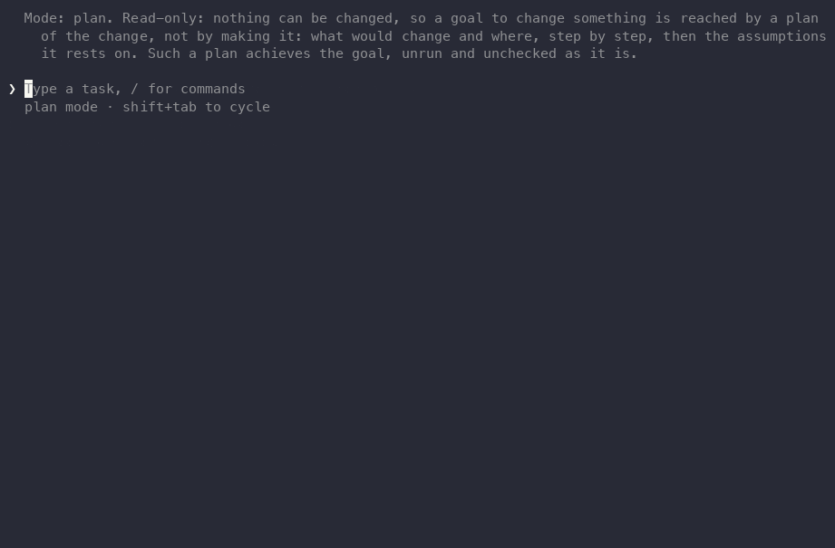
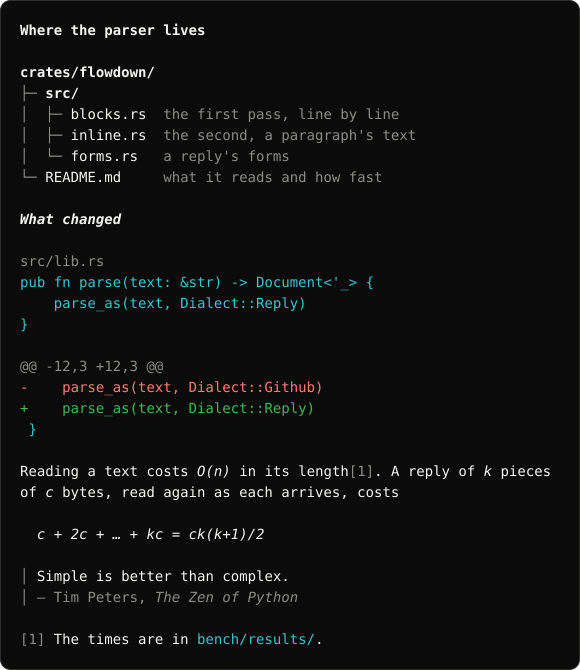
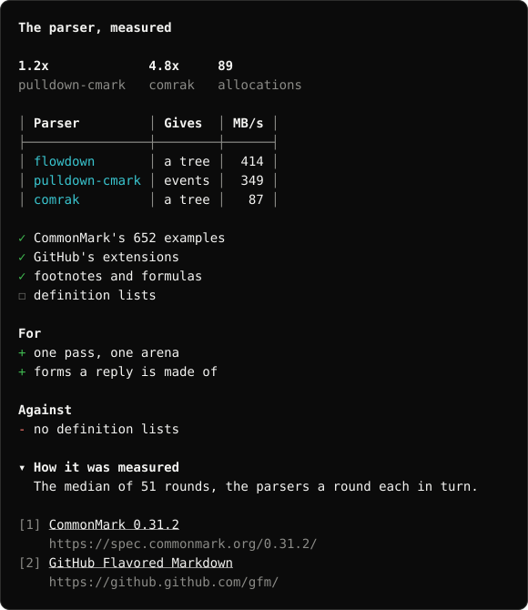

<p align="center">
  <picture>
    <source media="(prefers-color-scheme: dark)" srcset="site/public/logo.svg">
    
  </picture>
</p>

<h1 align="center">Localix CLI</h1>

<p align="center">
  <strong>An ultrafast, lightweight agent runtime for coding and CI</strong>
</p>

<p align="center">
  A coding agent at your terminal, on any model: a ChatGPT sign-in, OpenRouter, your own key or a local model (Ollama, LM Studio, llama.cpp). The same agent runs one task in CI and helps your other agents. One binary under 4 MB.
</p>

<p align="center">
  <a href="https://github.com/localixai/localix-cli/actions/workflows/ci.yml"></a>
  <a href="https://github.com/localixai/localix-cli/releases/latest"></a>
  <a href="LICENSE"></a>
  
</p>

<p align="center">
  <a href="#quick-start">Quick start</a> ·
  <a href="#at-your-terminal">At your terminal</a> ·
  <a href="#measured-beside-claude-code">Measured</a> ·
  <a href="#in-ci-and-scripts">In CI</a> ·
  <a href="#in-other-agents">In other agents</a> ·
  <a href="#documentation">Docs</a> ·
  <a href="https://cli.localix.ai">cli.localix.ai</a>
</p>

<p align="center">
  <a href="https://cli.localix.ai">
    
  </a>
</p>

<p align="center">
  <sub>Every step a real run on Claude Haiku 5.5: any model · a fix · answers · agents · a decision · a ship check. It plays on <a href="https://cli.localix.ai">cli.localix.ai</a> too, by chapter, where it can be paused and copied from.</sub>
</p>

## Quick start

**1. Install** on macOS or Linux:

```bash
curl -fsSL https://raw.githubusercontent.com/localixai/localix-cli/main/scripts/install.sh | sh
```

**2. Run it in your project:**

```bash
cd your-project
llx
```

**3. Sign in and ask:**

```text
/login
the median test fails, fix it
```

`/login` takes a ChatGPT sign-in, OpenRouter or a key for any of 200+ providers; a model on your own machine (Ollama, LM Studio) needs none. `llx doctor` says what is missing. Other ways to install: [Installing llx](docs/install.md).

## Why llx

llx is a model in a loop over five tools: `bash`, `apply_patch`, `ask`, `agents` and `jobs`. It reads, searches and runs your checks through the shell, and changes files with patches.

- **Fast and small.** One Rust binary under 4 MB. On the larger task [below](#measured-beside-claude-code) it finished in 60% of the time for a ninth of the cost.
- **Any model.** 1,000+ models from 200+ providers, and the ones on your own machine; `/model` lists every one you are signed in to ([models](MODELS.md)).
- **Sandboxed by default.** Commands run in the system's sandbox, which writes only inside your project (never its `.git`) and opens no network. What must reach further is asked first ([modes and trust](docs/modes.md)).
- **Answers you can read.** Code under its file's name, a diff in green and red, tables, steps and formulas, drawn in the terminal with no markup left over.
- **Saved.** Every run is a session: `llx -c` goes on with the newest one here, `llx sessions` lists them and `llx resume ID` opens one ([sessions](docs/usage.md#sessions)).

## At your terminal

What finished goes into the terminal's own scrollback, so scrolling, selecting and copying stay the terminal's. Several sessions can work in one project at once, each with agents of its own.

<p align="center">
  
  
</p>

<p align="center">
  <sub>The renderer's own rows, written as SVG. The Markdown is read by <a href="https://github.com/localixai/flowdown">flowdown</a>, the lab's library.</sub>
</p>

| Key | What it does |
| :-- | :-- |
| <kbd>Enter</kbd> | Sends. While a task works, what you type goes to it, read at its next step |
| <kbd>Shift</kbd>+<kbd>Tab</kbd> | Goes round the modes: `default` → `plan` (read-only) → `bypass` → your own |
| <kbd>/</kbd> | The commands: `/login`, `/model`, `/mode`, `/new`, `/rewind`, `/diff`, `/copy`, `/usage` and more |
| <kbd>@</kbd> | Mentions a file of the project; a dragged file or picture is attached |
| <kbd>←</kbd> | On an empty prompt, lists the sessions in this project |
| <kbd>Esc</kbd>,&nbsp;<kbd>Ctrl</kbd>+<kbd>C</kbd> | Steps back out of what is open; <kbd>Ctrl</kbd>+<kbd>C</kbd> also stops work |

Every key and command: [Using llx](docs/usage.md#in-a-session).

## Measured beside Claude Code

The same task, the same model, the same Anthropic key, started in the same minute; the tests that score a run were written before it.

| Task | Model | Agent | Solved | Time | Turns | Cost |
| :-- | :-- | :-- | --: | --: | --: | --: |
| evalkit, 238&nbsp;tests | Haiku&nbsp;5.5 | **llx** | 238&nbsp;of&nbsp;238 | **286&nbsp;s** | 14 | **$0.050** |
| | | Claude&nbsp;Code&nbsp;2.1.321 | 238&nbsp;of&nbsp;238 | 478&nbsp;s | 25 | $0.46 |
| shopkit, 69&nbsp;tests | Haiku&nbsp;5.5 | **llx** | 69&nbsp;of&nbsp;69 | 69&nbsp;s | 5 | $0.012 |
| | | Claude&nbsp;Code&nbsp;2.1.321 | 69&nbsp;of&nbsp;69 | 67&nbsp;s | 4 | $0.011 |

One run of each agent, on one machine: a measurement, not a law. Every run's log, code and test output are in [benchmark/](benchmark/README.md), the slower runs too ([history](benchmark/HISTORY.md)); `bun benchmark/run.ts` repeats it on your key.

## In CI and scripts

`llx exec` is the same agent given one task: it ends with an answer, in the shape a JSON Schema defines if you pass one, and an exit code your pipeline can branch on (0 done, 1 no data, 2 out of turns, time or budget, 3 error). It works through `bash` with `gh`, `git` and your project's tools, with no MCP server and no built-in prompt, so the same task runs on GitHub, GitLab or any runner with a shell.

```yaml
# a step of a job, after actions/checkout
- uses: localixai/localix-cli@v0
  id: llx
  env:
    OPENROUTER_API_KEY: ${{ secrets.OPENROUTER_API_KEY }}
    GH_TOKEN: ${{ github.token }} # read-only in this job; a second job posts the answer
    PR: ${{ github.event.pull_request.number }}
  with:
    model: anthropic/claude-haiku-5.5
    allow: bash
    schema: '{"type":"object","properties":{"summary":{"type":"string"}},"required":["summary"]}'
    prompt: |
      Review pull request #$PR with gh and git. Run something to confirm a problem
      before you report it.
```

Ready-made workflows, each run for real: a [pull request review](examples/github/review.yml), [`@llx` in any thread](examples/github/llx.yml), [issue triage](examples/github/triage.yml), [a failed run explained](examples/github/ci-failure.yml) and [more](examples/README.md). The action, the two-job pattern, keys, limits and GitLab: [CI](docs/ci.md). Exit codes and the `--json` events: [Reference](docs/reference.md).

## In other agents

Claude Code, Codex or a script of yours can call llx from its shell: `llx exec` hands a task to a helper on any model, so the agent's own tokens go where they matter, and `llx decide` picks one of a few options about some text in about a second. A skill tells any agent that takes skills when each pays:

```bash
npx skills add localixai/localix-cli
```

In Claude Code it is also a plugin: `/plugin install llx --marketplace localixai/localix-cli`. More: [In other agents](docs/agents.md).

## Documentation

All of it is also on [cli.localix.ai/docs](https://cli.localix.ai/docs).

| Guide | What it holds |
| :-- | :-- |
| [Installing llx](docs/install.md) | The install script, other ways, pinning a release, signing in |
| [Using llx](docs/usage.md) | The command line, a session key by key, models and local hosts, sessions, project instructions |
| [Modes and trust](docs/modes.md) | Modes, rules, approvals, the sandbox and its boundaries |
| [Tools](docs/tools.md) | The five tools: `bash`, `apply_patch`, `ask`, `agents`, `jobs` |
| [CI](docs/ci.md) · [Recipes](docs/recipes.md) · [Examples](examples/README.md) | The GitHub Action, the two-job pattern, shell recipes, ready-made workflows |
| [In other agents](docs/agents.md) | Helpers on any model, `llx decide`, the skill |
| [Reference](docs/reference.md) · [Compared](docs/compare.md) | Exit codes, `--json` events, `llx decide`; the action beside other agents' actions |
| [Architecture](ARCHITECTURE.md) · [Models](MODELS.md) · [Changelog](CHANGELOG.md) | The layers and their rules, the model catalog, what changed |

## Contributing

Start with [CONTRIBUTING.md](CONTRIBUTING.md) and [ARCHITECTURE.md](ARCHITECTURE.md). Report vulnerabilities as [SECURITY.md](SECURITY.md) describes. llx is open source under the [MIT License](LICENSE), made by [Localix Lab](https://localix.ai), built and reviewed with Claude Fable 5.2.

Before Localix CLI, this repository was auto-copilot-cli (2023, TypeScript), its author's first AI command line. llx is its successor, written anew in Rust.
